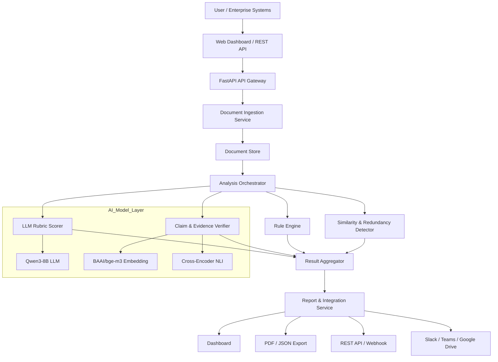

# WorkGuard — Kiến trúc hệ thống kiểm tra chất lượng tài liệu doanh nghiệp do AI hỗ trợ tạo ra

## 1. Tổng quan đề tài

**WorkGuard** là một nền tảng giúp doanh nghiệp kiểm tra chất lượng, căn cứ và tính hành động của các tài liệu nội bộ do AI hỗ trợ tạo ra, ví dụ memo, báo cáo tiến độ, đề xuất dự án, tài liệu kỹ thuật hoặc meeting notes.

Hệ thống không nhằm mục đích phát hiện “văn bản do AI viết”, mà nhằm phát hiện **workslop**: tài liệu trông chỉn chu, có cấu trúc và ngôn ngữ chuyên nghiệp, nhưng thiếu căn cứ, thiếu quyết định, thiếu hành động hoặc buộc người nhận phải tự diễn giải và làm lại.

**Workslop** được hiểu là output do generative AI tạo ra, trông có vẻ hoàn chỉnh nhưng thiếu chất lượng cần thiết để thực sự thúc đẩy công việc; người nhận phải dành thời gian kiểm tra, diễn giải, sửa chữa hoặc làm lại. [web:82][web:94]

### 1.1. Vấn đề giải quyết

Trong doanh nghiệp, nhân viên thường nhận các tài liệu như:

- “Team sẽ tiếp tục cải thiện hiệu năng.”
- “Chúng ta cần tăng cường cộng tác giữa các phòng ban.”
- “Dự án đang tiến triển tốt.”
- “Khách hàng rất hài lòng với sản phẩm.”

Những câu này nghe hợp lý nhưng thường không cho biết:

- Ai chịu trách nhiệm?
- Deadline là khi nào?
- Đã làm được gì, đo bằng số liệu nào?
- Còn blocker nào?
- Cần quyết định hay phê duyệt gì?
- Số liệu hoặc tuyên bố có căn cứ từ đâu?

WorkGuard phân tích tài liệu theo rubric và trả về:

- Điểm chất lượng tổng thể.
- Mức rủi ro: `ready`, `needs_revision`, `high_risk`.
- Danh sách finding cụ thể theo đoạn/câu.
- Lý do và bằng chứng cho từng finding.
- Gợi ý chỉnh sửa.
- Báo cáo PDF/JSON để lưu trữ hoặc chia sẻ.

### 1.2. Phạm vi MVP

Trong phạm vi đồ án 2 tháng, hệ thống tập trung vào 3 loại tài liệu:

1. **Project update / Báo cáo tiến độ**
2. **Memo / Thông báo nội bộ**
3. **Project proposal / Đề xuất dự án**

Các định dạng đầu vào:

- `.docx`
- `.pdf`
- `.md`
- `.txt`
- Văn bản dán trực tiếp

Hệ thống hỗ trợ tiếng Việt và tiếng Anh ở mức cơ bản.

## 2. Mục tiêu sản phẩm

### 2.1. Mục tiêu chức năng

WorkGuard cần thực hiện các chức năng sau:

- Upload tài liệu hoặc paste văn bản.
- Tự động xác định loại tài liệu.
- Trích xuất văn bản, tiêu đề, bullet, bảng và metadata.
- Phân tích tài liệu theo rubric.
- Phát hiện thiếu owner, deadline, next step, metric hoặc căn cứ.
- Phát hiện câu generic, lặp nội dung và tuyên bố không có căn cứ.
- Kiểm tra claim quan trọng với tài liệu nguồn, nếu người dùng cung cấp.
- Sinh báo cáo chất lượng có giải thích.
- Xuất báo cáo PDF/JSON.
- Cung cấp REST API để tích hợp vào hệ thống doanh nghiệp.

### 2.2. Mục tiêu phi chức năng

- **Dễ dùng:** người dùng upload tài liệu và nhận báo cáo trong vài phút.
- **Giải thích được:** mỗi finding phải có vị trí, lý do và gợi ý sửa.
- **Có thể mở rộng:** thêm loại tài liệu, rubric, ngôn ngữ hoặc tích hợp mới mà không đổi kiến trúc.
- **Bảo mật:** tài liệu doanh nghiệp phải được lưu có kiểm soát và hỗ trợ xóa dữ liệu theo yêu cầu.
- **Chi phí hợp lý:** ưu tiên rule-based checks và mô hình nhỏ; chỉ dùng LLM khi cần.

## 3. Kiến trúc tổng thể

### 3.1. Sơ đồ kiến trúc tổng thể

```text
┌─────────────────────────────────────────────────────────────┐
│                      Người dùng / Doanh nghiệp              │
│                                                             │
│   Web UI • Slack • Microsoft Teams • Google Drive • API     │
└──────────────────────────────┬──────────────────────────────┘
                               │
                               ▼
                    ┌────────────────────┐
                    │      API Gateway   │
                    │  FastAPI + Auth    │
                    └──────────┬─────────┘
                               │
                               ▼
                 ┌──────────────────────────────┐
                 │   Document Ingestion Service │
                 │  Upload / Parse / Normalize  │
                 └──────────────┬───────────────┘
                                │
                                ▼
                 ┌──────────────────────────────┐
                 │   Document Store & Metadata  │
                 │  PostgreSQL + Object Storage │
                 └──────────────┬───────────────┘
                                │
                                ▼
                 ┌──────────────────────────────┐
                 │    Analysis Orchestrator     │
                 │  Chọn rubric & điều phối     │
                 └───────┬───────────┬──────────┘
                         │           │
        ┌────────────────┘           └────────────────┐
        ▼                                             ▼
┌───────────────────┐                      ┌────────────────────────┐
│   Rule Engine     │                      │  LLM Analysis Service  │
│  Structure checks │                      │  Rubric scoring        │
│  Missing fields   │                      │  Claim extraction      │
│  Deadline/owner   │                      │  Suggestion generation │
└─────────┬─────────┘                      └───────────┬────────────┘
          │                                            │
          │                                            ▼
          │                             ┌────────────────────────────┐
          │                             │  Claim & Evidence Verifier │
          │                             │  Embedding + NLI + LLM     │
          │                             └───────────────┬────────────┘
          │                                             │
          ▼                                             ▼
┌─────────────────────────────────────────────────────────────────┐
│                     Result Aggregator                           │
│  Quality score • Risk level • Findings • Suggestions • Report   │
└──────────────────────────────┬──────────────────────────────────┘
                               │
                               ▼
                 ┌──────────────────────────────┐
                 │  Report & Integration Service│
                 │  Dashboard • PDF • JSON      │
                 │  REST API • Webhook          │
                 └──────────────────────────────┘
```

### 3.2. Luồng xử lý chính

```text
1. Người dùng upload tài liệu hoặc paste văn bản.
2. API Gateway xác thực và tạo analysis job.
3. Document Ingestion Service trích văn bản, cấu trúc và metadata.
4. Orchestrator xác định loại tài liệu và chọn rubric.
5. Rule Engine chạy các kiểm tra cấu trúc nhanh.
6. LLM Rubric Scorer chấm từng tiêu chí chất lượng.
7. Claim & Evidence Verifier kiểm tra các tuyên bố quan trọng.
8. Similarity Detector phát hiện nội dung lặp hoặc generic.
9. Result Aggregator gộp kết quả và tính risk level.
10. Report Service sinh dashboard, PDF và JSON.
11. Hệ thống gửi webhook hoặc notification nếu cần.
```

## 4. Thành phần hệ thống

### 4.1. API Gateway

**Công nghệ:** FastAPI

**Chức năng:**

- Nhận request upload và analyze.
- Xác thực người dùng bằng JWT.
- Phân quyền theo role: `user`, `reviewer`, `admin`.
- Giới hạn số request.
- Ghi audit log.
- Trả về `202 Accepted` khi job đang xử lý nền.

FastAPI hỗ trợ background task; với tác vụ nặng hoặc cần chạy nhiều worker, Celery cùng Redis/RabbitMQ là lựa chọn phù hợp hơn. [web:95][web:96][web:102]

### 4.2. Document Ingestion Service

**Chức năng:**

- Nhận file từ web UI hoặc API.
- Trích văn bản từ DOCX, PDF, Markdown, TXT.
- Nhận diện section, heading, bullet, bảng và metadata.
- Tạo document ID và version.
- Lưu raw file vào object storage.
- Lưu normalized text vào database.

**Công cụ đề xuất:**

| Nhu cầu | Công cụ |
|---|---|
| DOCX parsing | `python-docx` |
| PDF parsing | `PyMuPDF` hoặc `pypdf` |
| Markdown parsing | `markdown-it-py` |
| Text normalization | `spaCy` hoặc regex |
| File storage | MinIO / S3-compatible storage |
| Metadata | PostgreSQL |

### 4.3. Document Store & Metadata

**Công nghệ:** PostgreSQL + MinIO/S3-compatible storage

**Dữ liệu lưu:**

- Thông tin tài liệu: ID, tên, loại, người upload, thời gian.
- Nội dung đã trích xuất.
- Cấu trúc section/paragraph.
- Kết quả phân tích.
- Findings.
- Claims và evidence.
- Audit log.

### 4.4. Analysis Orchestrator

**Chức năng:**

- Nhận document ID.
- Xác định document type.
- Load rubric tương ứng.
- Chia tài liệu thành các phần nhỏ.
- Gọi Rule Engine, LLM Scorer, Claim Verifier và Similarity Detector.
- Gộp kết quả.
- Cập nhật trạng thái analysis job.

**Công nghệ:** Python + Celery + Redis

### 4.5. Rule Engine

Đây là lớp kiểm tra nhanh, rẻ và dễ giải thích.

**Các rule chính:**

| Rule | Mục đích | Ví dụ |
|---|---|---|
| Missing owner | Phát hiện action item không có người phụ trách | “Team sẽ xử lý” |
| Missing deadline | Phát hiện thiếu mốc thời gian | “Sẽ hoàn thành sớm” |
| Vague action | Phát hiện hành động không đo lường được | “Cải thiện hiệu năng” |
| Missing metric | Phát hiện thiếu KPI hoặc cách đo | “Tăng hiệu quả” |
| Generic phrasing | Phát hiện câu chung chung | “Tăng cường cộng tác” |
| Repetition | Phát hiện nội dung lặp | Hai đoạn nói cùng một ý |
| Unsupported number | Phát hiện số liệu không có nguồn | “Tăng 30%” nhưng không có nguồn |
| Missing decision | Phát hiện thiếu quyết định hoặc next step | Không nói rõ cần phê duyệt gì |

### 4.6. LLM Rubric Scorer

Đây là thành phần chính dùng LLM để đánh giá chất lượng theo rubric.

**Input:**

- Document type.
- Document section.
- Rubric criteria.
- Metadata: audience, deadline, mục tiêu tài liệu.
- Optional: tài liệu nguồn.

**Output JSON:**

```json
{
  "criterion": "actionability",
  "score": 1,
  "max_score": 5,
  "verdict": "fail",
  "reason": "The update does not specify owners, deadlines, or required decisions.",
  "evidence": [
    {
      "location": "section_2/paragraph_3",
      "quote": "The team will continue improving performance."
    }
  ],
  "suggestion": "Add owner, deadline, success metric, and required decision."
}
```

LLM-as-judge nên đánh giá theo rubric có cấu trúc và trả về JSON có schema cố định; cách này giúp kết quả có thể parse, lưu trữ và so sánh giữa các lần chạy. [web:83][web:85][web:87][web:88][web:90]

### 4.7. Claim & Evidence Verifier

**Mục tiêu:** kiểm tra các tuyên bố quan trọng có được tài liệu nguồn hỗ trợ hay không.

**Pipeline:**

```text
Document → Claim extraction → Evidence retrieval → Entailment check → Verdict
```

**Các loại verdict:**

- `supported`
- `partially_supported`
- `unsupported`
- `contradicted`
- `insufficient_evidence`

**Ví dụ:**

```text
Claim: “Doanh thu tăng 20% trong Q3.”
Source: “Doanh thu Q3 tăng 12% so với Q2.”
Verdict: contradicted
```

**Công nghệ:**

| Thành phần | Công cụ |
|---|---|
| Embedding | BAAI/bge-m3 |
| Vector store | Qdrant hoặc pgvector |
| NLI / entailment | `cross-encoder/nli-deberta-v3-base` hoặc tương đương |
| Fallback judge | Qwen3-8B hoặc LLM API |

BGE-M3 hỗ trợ đa ngôn ngữ, dense/sparse/multi-vector retrieval và đầu vào dài tới 8.192 token, phù hợp cho tài liệu doanh nghiệp đa ngôn ngữ. [web:97]

### 4.8. Similarity & Redundancy Detector

**Chức năng:**

- Phát hiện đoạn lặp.
- Phát hiện câu generic.
- Phát hiện nội dung filler.
- Đánh dấu các đoạn có similarity cao.

**Công nghệ:**

- SentenceTransformers hoặc BGE-M3 embedding.
- Cosine similarity.
- Rule-based phrase detector.
- LLM classifier cho các trường hợp khó.

### 4.9. Result Aggregator

**Chức năng:**

- Gộp kết quả từ các analyzer.
- Tính overall score.
- Xác định risk level.
- Ưu tiên finding theo severity.
- Sinh summary và recommended actions.

**Công thức gợi ý:**

\[
\text{Quality Score} = \sum_{i=1}^{n} w_i \times s_i
\]

Trong đó:

- \(w_i\): trọng số tiêu chí.
- \(s_i\): điểm tiêu chí.
- \(n\): số tiêu chí.

**Risk level:**

| Score | Risk level |
|---|---|
| 80–100 | `ready` |
| 50–79 | `needs_revision` |
| 0–49 | `high_risk` |

### 4.10. Report & Integration Service

**Chức năng:**

- Sinh báo cáo PDF.
- Sinh JSON report.
- Hiển thị dashboard.
- Gửi webhook.
- Tích hợp Slack/Teams/Drive.
- Lưu audit trail.

## 5. Kiến trúc kỹ thuật đề xuất

### 5.1. Công nghệ sử dụng

| Thành phần | Công nghệ đề xuất |
|---|---|
| Backend API | FastAPI |
| Database | PostgreSQL |
| Cache / queue | Redis |
| Background worker | Celery |
| Object storage | MinIO hoặc S3-compatible |
| Vector store | Qdrant hoặc PostgreSQL + pgvector |
| Embedding model | BAAI/bge-m3 |
| LLM chính | Qwen3-8B hoặc LLM API |
| NLI model | `cross-encoder/nli-deberta-v3-base` |
| Document parsing | `python-docx`, `PyMuPDF`, `markdown-it-py` |
| Frontend | React/Next.js hoặc Streamlit |
| Containerization | Docker + Docker Compose |
| Monitoring | Prometheus + Grafana hoặc structured logs |

Qwen3-8B là mô hình ngôn ngữ 8.2B tham số, hỗ trợ context dài tới 32.768 token và có thể chạy cục bộ hoặc qua API; phù hợp làm LLM judge hoặc generator trong MVP. [web:98][web:100][web:101][web:108]

### 5.2. Kiến trúc deployment MVP

```text
┌──────────────────────────────────────────────┐
│                 Docker Compose               │
│                                              │
│  ┌────────────┐   ┌────────────┐             │
│  │  Frontend  │──▶│  FastAPI   │             │
│  └────────────┘   └─────┬──────┘             │
│                         │                    │
│              ┌──────────┴──────────┐         │
│              │                     │         │
│        ┌─────▼─────┐         ┌─────▼─────┐   │
│        │ PostgreSQL│         │   Redis   │   │
│        └───────────┘         └─────┬─────┘   │
│                                    │         │
│                             ┌──────▼──────┐  │
│                             │   Celery    │  │
│                             │   Worker    │  │
│                             └──────┬──────┘  │
│                                    │         │
│        ┌───────────────────────────┴───────┐ │
│        │       Analysis Services           │ │
│        │  Rule Engine • LLM • Verifier     │ │
│        └───────────────────────────────────┘ │
│                                              │
│  ┌────────────┐   ┌────────────┐             │
│  │   MinIO    │   │   Qdrant   │             │
│  └────────────┘   └────────────┘             │
└──────────────────────────────────────────────┘
```

## 6. Database schema

### 6.1. Bảng `users`

```sql
CREATE TABLE users (
    id UUID PRIMARY KEY,
    email VARCHAR(255) UNIQUE NOT NULL,
    role VARCHAR(50) NOT NULL,
    organization_id UUID NOT NULL,
    created_at TIMESTAMP DEFAULT NOW()
);
```

### 6.2. Bảng `documents`

```sql
CREATE TABLE documents (
    id UUID PRIMARY KEY,
    org_id UUID NOT NULL,
    uploader_id UUID NOT NULL,
    doc_type VARCHAR(50),
    title VARCHAR(255),
    file_url TEXT,
    raw_text TEXT,
    status VARCHAR(50),
    created_at TIMESTAMP DEFAULT NOW()
);
```

### 6.3. Bảng `document_sections`

```sql
CREATE TABLE document_sections (
    id UUID PRIMARY KEY,
    document_id UUID NOT NULL,
    section_id VARCHAR(50),
    title VARCHAR(255),
    content TEXT,
    order_index INT,
    created_at TIMESTAMP DEFAULT NOW()
);
```

### 6.4. Bảng `analysis_runs`

```sql
CREATE TABLE analysis_runs (
    id UUID PRIMARY KEY,
    document_id UUID NOT NULL,
    rubric_version VARCHAR(50),
    model_version VARCHAR(100),
    status VARCHAR(50),
    overall_score FLOAT,
    risk_level VARCHAR(50),
    created_at TIMESTAMP DEFAULT NOW()
);
```

### 6.5. Bảng `findings`

```sql
CREATE TABLE findings (
    id UUID PRIMARY KEY,
    analysis_run_id UUID NOT NULL,
    type VARCHAR(100),
    severity VARCHAR(50),
    location VARCHAR(255),
    message TEXT,
    suggestion TEXT,
    evidence JSONB,
    created_at TIMESTAMP DEFAULT NOW()
);
```

### 6.6. Bảng `claims`

```sql
CREATE TABLE claims (
    id UUID PRIMARY KEY,
    document_id UUID NOT NULL,
    claim_text TEXT,
    source_text TEXT,
    verdict VARCHAR(50),
    confidence FLOAT,
    created_at TIMESTAMP DEFAULT NOW()
);
```

## 7. API chính

| Endpoint | Method | Mục đích |
|---|---|---|
| `/api/v1/documents` | POST | Upload tài liệu |
| `/api/v1/documents/{id}` | GET | Xem metadata và trạng thái |
| `/api/v1/documents/{id}/analyze` | POST | Chạy phân tích |
| `/api/v1/analyses/{id}` | GET | Xem kết quả phân tích |
| `/api/v1/analyses/{id}/report` | GET | Tải PDF/JSON report |
| `/api/v1/rubrics` | GET | Xem rubric |
| `/api/v1/webhooks` | POST | Nhận callback từ Slack/Teams/Drive |

## 8. Rubric cốt lõi

### 8.1. Purpose clarity

**Câu hỏi:** Tài liệu có nói rõ mục đích, người nhận và kết quả mong muốn không?

**Ví dụ lỗi:**

- “Cập nhật tiến độ dự án.”
- “Báo cáo tình hình hiện tại.”

### 8.2. Actionability

**Câu hỏi:** Có next step, owner, deadline, quyết định hoặc yêu cầu cụ thể không?

**Ví dụ lỗi:**

- “Team sẽ tiếp tục cải thiện hiệu năng.”
- “Cần thảo luận thêm.”

### 8.3. Evidence & grounding

**Câu hỏi:** Các tuyên bố quan trọng có số liệu, nguồn, trích dẫn hoặc căn cứ không?

**Ví dụ lỗi:**

- “Khách hàng rất hài lòng.”
- “Hiệu quả tăng đáng kể.”

### 8.4. Specificity

**Câu hỏi:** Có tránh ngôn ngữ chung chung, lặp và filler không?

**Ví dụ lỗi:**

- “Tối ưu quy trình, nâng cao hiệu quả, tăng cường cộng tác.”

### 8.5. Consistency & verifiability

**Câu hỏi:** Số liệu, mốc thời gian và trích dẫn có tự nhất quán và kiểm chứng được không?

**Ví dụ lỗi:**

- Báo cáo nói tăng 20% nhưng bảng đính kèm cho thấy 12%.

## 9. Master prompt để tạo hình ảnh kiến trúc

Dưới đây là master prompt dùng để tạo hình ảnh kiến trúc hệ thống WorkGuard bằng công cụ tạo ảnh AI.

```text
Create a clean, modern, professional enterprise software architecture diagram for a system called “WorkGuard”.

WorkGuard is an AI-powered document quality and workslop detection platform for enterprises. It analyzes internal business documents such as memos, project updates, project proposals, reports, and meeting notes. It does not detect whether text was written by AI. Instead, it evaluates whether a document is clear, evidence-based, actionable, and useful for decision-making.

The diagram should show a layered enterprise architecture with clear boxes, arrows, labels, and a modern minimal color palette: white background, dark navy text, blue primary accents, light gray containers, and subtle orange highlights for AI/LLM components.

Show the following major layers from top to bottom:

1. USER & ENTERPRISE INTEGRATION LAYER
- Web Dashboard
- REST API clients
- Slack
- Microsoft Teams
- Google Drive
- Enterprise document systems

2. API GATEWAY LAYER
- FastAPI API Gateway
- Authentication and authorization
- JWT authentication
- Role-based access control
- Rate limiting
- Audit logging
- Request validation

3. DOCUMENT INGESTION LAYER
- Document Upload Service
- File type detection
- DOCX parser
- PDF parser
- Markdown parser
- Text normalizer
- Metadata extractor
- Document chunker
- Object storage connection

4. DOCUMENT STORE LAYER
- PostgreSQL relational database
- Document metadata
- Document sections
- Analysis runs
- Findings
- Claims
- Audit logs
- MinIO / S3-compatible object storage for original files

5. ANALYSIS ORCHESTRATION LAYER
- Analysis Orchestrator
- Document type classifier
- Rubric selector
- Celery task queue
- Redis message broker
- Job status tracker
- Error handler and retry mechanism

6. QUALITY ANALYSIS ENGINE LAYER
Show these four parallel analysis modules:
- Rule Engine: missing owner, missing deadline, vague action, missing metric, generic phrasing, repetition, unsupported numbers, missing decision
- LLM Rubric Scorer: purpose clarity, actionability, evidence and grounding, specificity, consistency and verifiability
- Claim & Evidence Verifier: claim extraction, evidence retrieval, embedding search, NLI entailment checking, contradiction detection
- Similarity and Redundancy Detector: duplicate detection, generic language detection, filler detection, semantic similarity

7. AI / MODEL LAYER
Clearly label the AI components:
- Qwen3-8B as the main LLM for rubric scoring, claim extraction, explanation, and suggestion generation
- BAAI/bge-m3 as the multilingual embedding model for semantic search and similarity detection
- Cross-encoder NLI model for claim entailment and contradiction detection
- Optional external LLM API as a fallback or scalable inference option
- Optional local GPU inference using Kaggle GPU or Docker-based inference service

8. RESULT AGGREGATION LAYER
- Result Aggregator
- Weighted rubric scoring
- Risk level classification: ready, needs_revision, high_risk
- Finding prioritization
- Summary generation
- Recommendation generation

9. REPORTING & INTEGRATION LAYER
- Web dashboard
- Document quality report
- Findings panel
- Evidence panel
- Suggested revisions
- PDF export
- JSON export
- REST API responses
- Webhooks
- Slack / Teams / Google Drive integration

10. SECURITY & OBSERVABILITY SIDE PANEL
- JWT authentication
- Role-based access control
- Audit log
- Encryption at rest
- Data retention policy
- Structured logs
- Prometheus metrics
- Grafana monitoring

Use a clean technical diagram style suitable for a university graduation project report or an enterprise software architecture presentation. Use rounded rectangles for services, cylinders for databases, cloud-like shapes for external integrations, and arrows to show data flow.

Make all labels readable in English. Avoid clutter, avoid photorealism, avoid 3D effects, avoid excessive decoration. The diagram should look like a professional cloud-native software architecture diagram, similar to a high-quality technical whitepaper figure.

Aspect ratio: 16:9.
Resolution: high resolution, suitable for a presentation slide or report figure.
```

## 10. Master prompt ngắn gọn

Nếu công cụ tạo ảnh có giới hạn ký tự, dùng prompt ngắn sau:

```text
Create a clean, modern enterprise software architecture diagram for “WorkGuard”, an AI-powered document quality and workslop detection platform for businesses.

Show a layered architecture with clear boxes, labels and arrows. Use a white background, dark navy text, blue primary accents, light gray containers, and subtle orange highlights for AI/LLM components.

Top layer: Web Dashboard, REST API clients, Slack, Microsoft Teams, Google Drive, enterprise document systems.

Second layer: FastAPI API Gateway with JWT authentication, role-based access control, rate limiting and audit logging.

Third layer: Document Ingestion Service with DOCX parser, PDF parser, Markdown parser, text normalizer, metadata extractor and document chunker.

Fourth layer: Document Store with PostgreSQL, MinIO/S3-compatible object storage, document metadata, sections, findings, claims and audit logs.

Fifth layer: Analysis Orchestrator with Celery task queue, Redis message broker, document type classifier, rubric selector, job status tracker and retry mechanism.

Sixth layer: Quality Analysis Engine with four parallel modules:
1. Rule Engine: missing owner, missing deadline, vague action, missing metric, generic phrasing, repetition, unsupported numbers, missing decision.
2. LLM Rubric Scorer: purpose clarity, actionability, evidence and grounding, specificity, consistency.
3. Claim & Evidence Verifier: claim extraction, evidence retrieval, embedding search, NLI entailment, contradiction detection.
4. Similarity and Redundancy Detector: duplicate detection, generic language detection, filler detection, semantic similarity.

Seventh layer: AI / Model Layer with Qwen3-8B as the main LLM, BAAI/bge-m3 as the multilingual embedding model, cross-encoder NLI model, optional external LLM API, and optional local GPU inference on Kaggle.

Eighth layer: Result Aggregator with weighted rubric scoring, risk classification, finding prioritization, summary generation and recommendations.

Ninth layer: Reporting & Integration Service with dashboard, PDF export, JSON export, REST API, webhooks, Slack/Teams/Google Drive integration.

Add a side panel for Security & Observability: JWT, role-based access control, audit log, encryption, data retention, structured logs, Prometheus metrics and Grafana monitoring.

Use a clean technical diagram style suitable for a university graduation project report or enterprise software architecture presentation. Use rounded rectangles for services, cylinders for databases, cloud-like shapes for external integrations, and arrows for data flow.

All labels must be readable in English. Avoid clutter, photorealism, 3D effects and excessive decoration.

Aspect ratio: 16:9.
High resolution.
```

## 11. Master prompt tạo sơ đồ Mermaid

Nếu bạn muốn tạo sơ đồ bằng Mermaid thay vì ảnh AI, dùng code sau:



## 12. Kế hoạch triển khai 8 tuần

| Tuần | Mục tiêu | Kết quả |
|---|---|---|
| 1 | Xác định use case, thu thập/tạo 100–200 mẫu, xây rubric v1 | Dataset thô + rubric |
| 2 | Xây parser DOCX/PDF/Markdown và pipeline xử lý văn bản | Module ingestion |
| 3 | Xây rule-based checks và LLM rubric scorer | Prototype CLI/API |
| 4 | Xây claim/evidence checker và gợi ý sửa | Phiên bản phân tích đầy đủ |
| 5 | Gán nhãn 50–100 mẫu, đo agreement, hiệu chỉnh rubric/threshold | Evaluation report v1 |
| 6 | Xây web UI: upload, dashboard, report, export | MVP web |
| 7 | Đóng gói REST API, Docker, integration hook; chạy pilot nhỏ | Bản demo enterprise-ready |
| 8 | Viết báo cáo, benchmark, demo video, tài liệu hướng dẫn | Đồ án hoàn chỉnh |

## 13. Điểm khác biệt của WorkGuard

WorkGuard khác một công cụ kiểm tra ngữ pháp hoặc phát hiện AI-generated text ở chỗ nó đánh giá **chất lượng công việc**, chứ không chỉ hình thức văn bản.

Các điểm khác biệt chính:

- **Rubric theo nhiệm vụ:** đánh giá tài liệu có giúp người nhận ra quyết định hoặc hành động không.
- **Finding có vị trí:** chỉ ra đúng đoạn, câu hoặc bullet có vấn đề.
- **Claim-level verification:** kiểm tra từng tuyên bố có căn cứ hay không.
- **Actionability scoring:** đo tài liệu có next step, owner, deadline và metric hay không.
- **Explainable output:** mỗi finding có evidence và suggestion.
- **Enterprise integration:** hỗ trợ API, webhook và export để tích hợp vào workflow.

Đây là điểm khiến WorkGuard có thể phát triển thành một sản phẩm doanh nghiệp thực sự, chứ không chỉ là một demo chatbot. [web:82][web:83][web:85][web:94]
